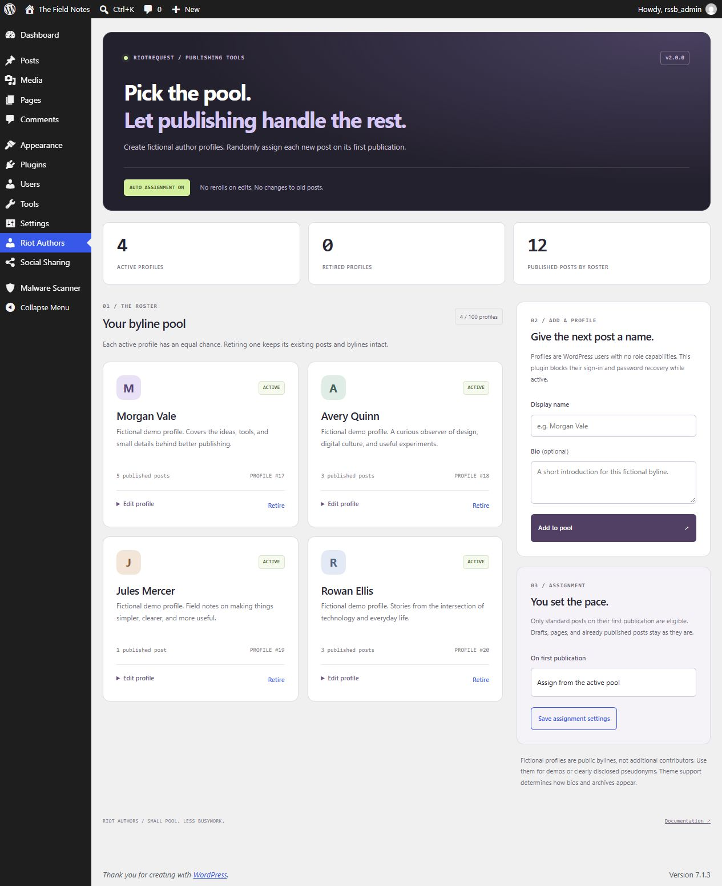
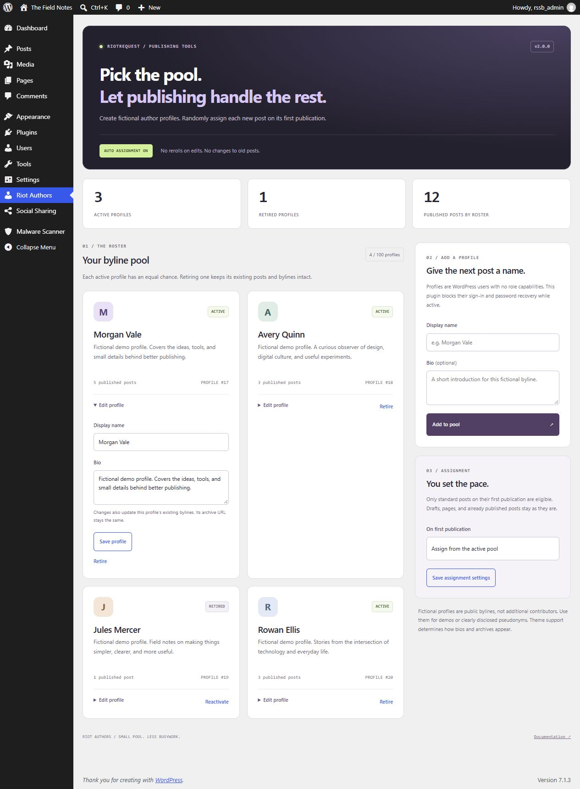

# Riot Authors

**Create the profiles. Publish the post. Let the pool pick the byline.**

Riot Authors is a small WordPress plugin that randomly assigns new posts to fictional author profiles on their first publication. Build a roster, add names and bios, and retire profiles when you want them out of rotation. Existing posts stay published under their current bylines.



## What's here

- **A proper author pool.** Add and edit display names and plain-text bios from the WordPress admin. No PHP edits, email addresses, or passwords to manage.
- **Assignment at publication.** Drafts keep their chosen author until first publication. Standard publishing, the block editor / REST API, and WordPress scheduled publication use the same pool.
- **No rerolls on edits.** Once a publication has been observed by v2, later edits and republication do not select a different author.
- **Retire, don't destroy.** Retired profiles stop receiving new assignments. Their accounts, existing bylines, and post statuses stay intact. Reactivate them whenever you like.
- **Pause whenever you want.** New publications keep their chosen author while assignment is paused or the active pool is empty.
- **Bylines without sign-in access.** Dummy profiles have an empty role capability set. While the plugin is active, it also blocks their password login, existing session authentication, password recovery, and application passwords.
- **Native WordPress, no build step.** No JavaScript framework, jQuery dependency, external fonts, avatar requests, API keys, or external services. The forms work without JavaScript.

The dashboard's published-post count includes all currently published standard posts authored by the roster, including retired profiles. It is not an all-time assignment counter.

## Install

Requires **single-site WordPress 6.3+**, **PHP 7.4+**, and an administrator account. Use a maintained PHP release.

1. Download the repository or the plugin ZIP.
2. Put its contents in `wp-content/plugins/riot-authors/`. Keep `dummy-author-replacer.php`, the CSS file, and the JS file together.
3. Activate **Riot Authors** under **Plugins**.
4. Open **Riot Authors** in the admin menu.
5. Add a display name and optional bio. The new profile immediately joins the active pool.
6. Create a new standard post and publish it. Its author is selected randomly from that pool.

Assignment is enabled by default, matching the original plugin's purpose. An empty pool leaves posts alone. You can pause assignment before adding profiles.

**Version 2 records the highest existing post ID when first installed or upgraded. Posts and drafts that already existed at that point are excluded from automatic assignment.** There is no bulk reassignment or backfill.

## How assignment works

```text
New standard post → draft / scheduled → first publication
                                          │
                   new since v2 setup, enabled, active pool?
                            │ yes                  │ no
                   choose one profile       keep chosen author
                            └──── remember this publication ────┘

Later edits or republication → keep the current author
```

Every active, eligible profile has an equal chance on each assignment. This is independent random selection, not round-robin scheduling: the same profile can be chosen for consecutive posts, and short runs will not necessarily look evenly distributed.

The selected profile replaces the post's chosen author on its first eligible publication. Pages, attachments, revisions, autosaves, custom post types, and pre-upgrade content are excluded. Profiles with extra roles or individually granted capabilities are excluded and cannot be edited through this console.

An assignment stores private post metadata with the original author ID, selected author ID, and timestamp. This is not an undo interface or a permanent audit service. A later deliberate author change through WordPress is respected; the plugin does not keep enforcing its previous choice.

Publications observed while paused or with an empty pool are remembered too. Enabling assignment later does not backfill them. The plugin cannot track publication while it is deactivated, and publishing tools that bypass normal WordPress insert hooks can bypass assignment. Other plugins that alter authorship or post metadata can affect the result; test integrations on staging.

## Manage the roster

| Control | Result |
| --- | --- |
| **Add to pool** | Creates a WordPress user with the exclusive `dummy_author` role, a generated internal login, and a strong random password. No email address is required and the plugin sends no account invitation. |
| **Edit profile** | Changes the display name and bio. Existing bylines using that account update too. Its author archive slug stays unchanged. |
| **Retire** | Excludes the profile from future selections. Its published posts remain published and attributed to it. |
| **Reactivate** | Returns a retired, eligible profile to the pool. |
| **Save assignment settings** | Enables or pauses future assignment. No existing post is reassigned. |

The roster supports **100 profiles total**, including retired profiles. This keeps the interface and random selection small and predictable. A legacy roster over the limit displays a notice; only the first 100 accounts by ID are considered for selection. Use WordPress Users to review excess accounts.

Names must be unique within the roster, between 1 and 100 bytes after sanitization; bios are limited to 1,000 bytes. The limits use UTF-8 bytes, so non-ASCII names may reach the limit sooner than the browser's character counter suggests. HTML is stripped. Archive slug collisions are handled by WordPress; non-Latin names can use a generated fallback slug. Theme support determines how author names, bios, and archives appear publicly.



The screenshots come from a disposable WordPress installation. All displayed profiles are fictional demo data.

## Accounts and access

Only users with `manage_options` can open or submit the console. Creating a profile also requires `create_users`; editing or changing pool membership requires permission to edit that user. All writes use POST forms and WordPress nonce checks. Administrator accounts, mixed-role accounts, and profiles with extra permissions are refused at the shared mutation boundary.

New dummy profiles have no role capabilities. Sign-in and password-recovery restrictions apply **while this plugin is active** to users whose only role is `dummy_author`. Promoting a profile to a normal user role takes it outside these restrictions and outside the assignment pool. Deactivating the plugin removes its authentication filters, so do not treat it as a permanent account lockdown. Manage real user security through WordPress.

**Multisite is not supported by this release.** The console displays an explanation; profile management, automatic assignment, and dummy authentication restrictions do not run on multisite. This avoids changing shared network accounts from an individual site's pool.

Fictional profiles are public bylines, not additional contributors. Use them for demos or clearly disclosed pseudonyms. If you need real editorial attribution or coauthors, use actual contributor accounts and an appropriate editorial workflow.

## Upgrading from 1.2

Back up the database before updating a plugin that changes users or authorship. Keep the existing plugin directory and `dummy-author-replacer.php` entry point when replacing its files; do not activate two copies.

- Existing exclusive `dummy_author` accounts are recognized and join the pool unless retired or privileged. The previously missing role is registered on activation and initialization.
- Pre-upgrade posts and drafts are left alone, including bylines the old version assigned during draft creation.
- New posts are assigned on first publication, replacing the old initial-save behavior.
- The old **Delete** action and its AJAX endpoints are removed. There is no plugin action that deletes users, drafts their posts, or transfers their content.
- Use **Retire** to remove a profile from rotation. If you truly need to delete an account, use WordPress Users and review WordPress's content reassignment options yourself.

Deactivation stops assignment and keeps users, bylines, settings, and private assignment metadata. Deleting the plugin files does not automatically delete that data. There is no bulk cleanup or uninstall deletion routine.

## Development

No package install or build step:

```sh
php -l dummy-author-replacer.php
node --check riot-authors-admin-script.js
```

For integration checks, use a **disposable single-site WordPress installation**, activate this plugin, and add this to that test site's `wp-config.php` before WordPress loads:

```php
define('RIOT_AUTHORS_TESTING', true);
```

Then run:

```sh
php tests/integration.php /path/to/disposable-wordpress/wp-load.php
```

The checks create and remove test users and posts, temporarily retire the existing test pool, change assignment settings, exercise real forms and REST publication, and restore the original pool and settings. **Do not run them on a production site.**

For v2.0.0, **47 checks passed on each of WordPress 6.3 and 7.1.3**, using PHP 8.2.12 on Windows. Coverage includes draft, direct, scheduled, and REST publishing; pause and empty-pool behavior; retirement and reactivation; name sanitization; capability and nonce rejection; actual session cookies; and immediate REST author responses. PHP lint and JavaScript syntax checks also passed.

## License

[MIT](LICENSE), continuing the license stated in the original README.
